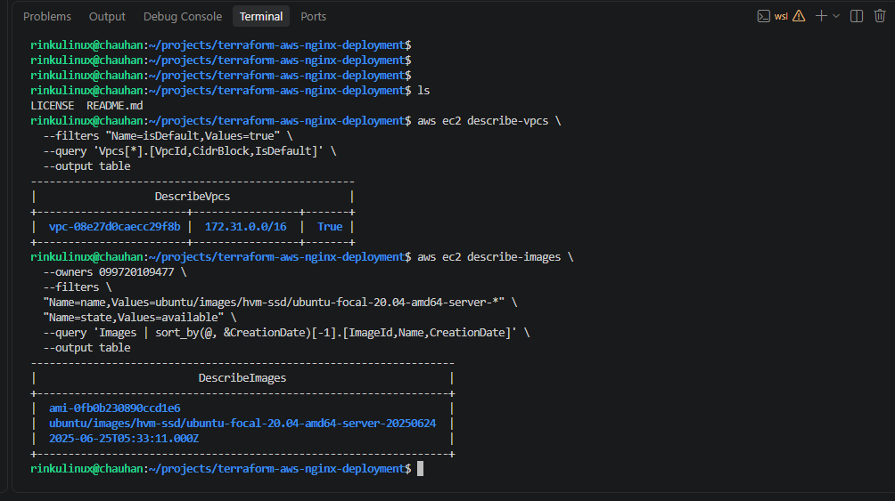
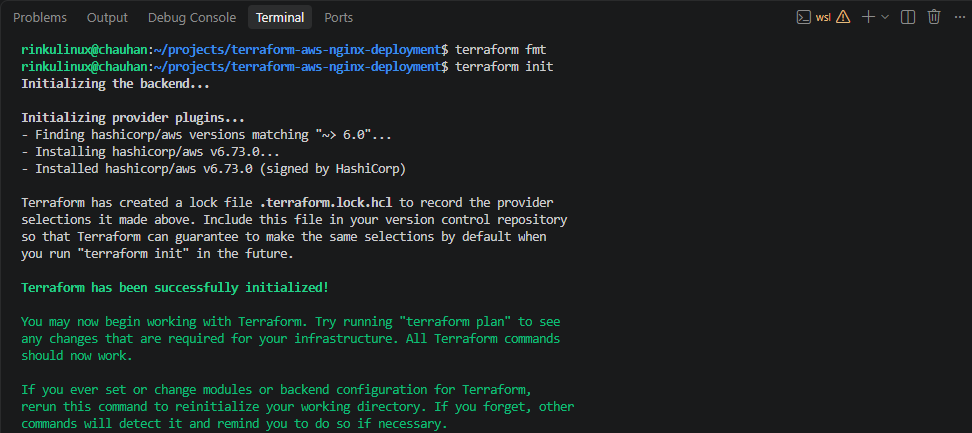
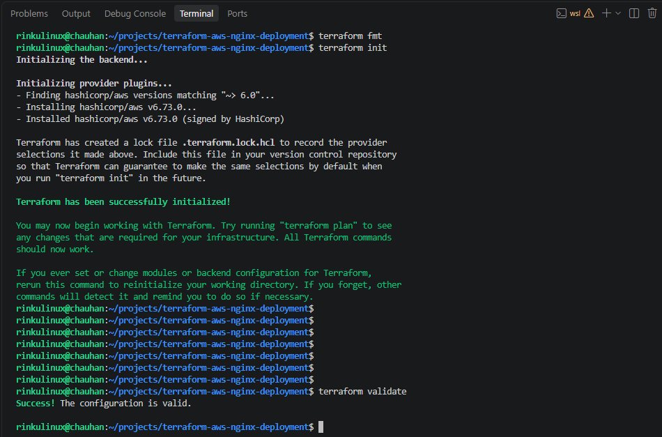
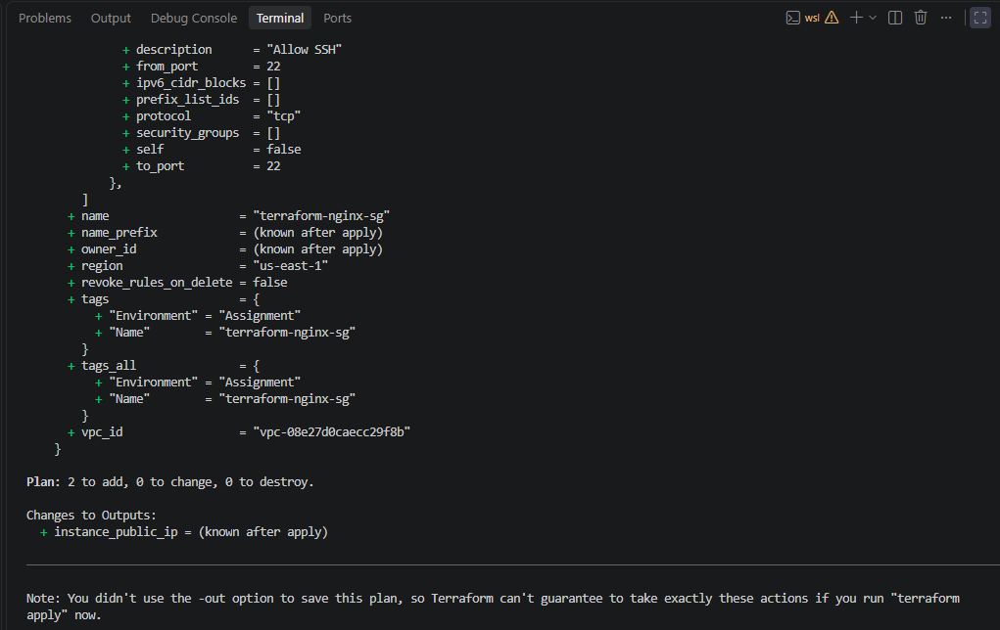
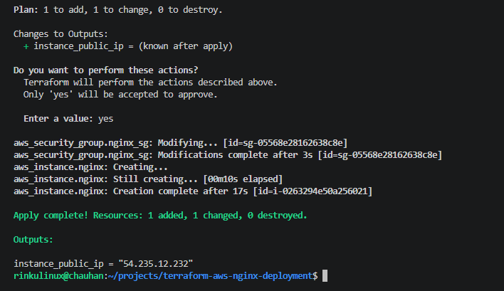
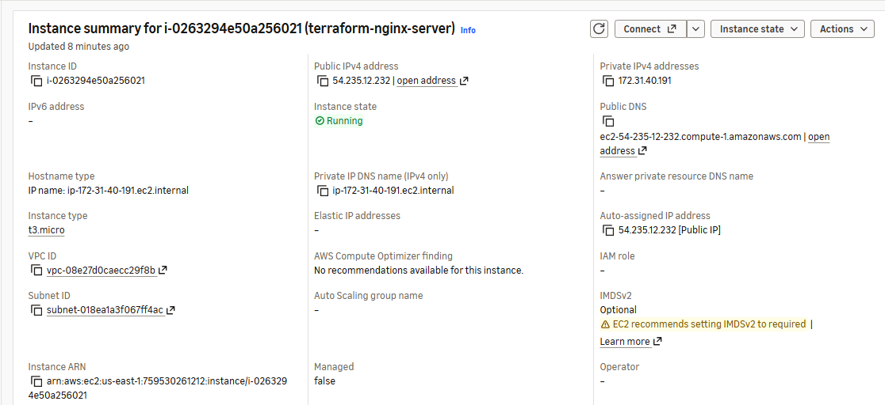
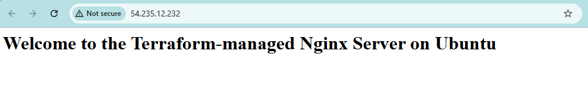
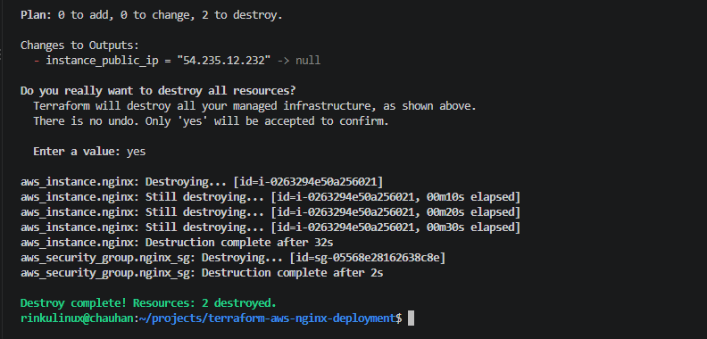

# Terraform AWS Nginx Deployment

## Project Overview

This project demonstrates Infrastructure as Code (IaC) using Terraform to provision an Ubuntu EC2 instance on AWS and deploy an Nginx web server.

The Nginx installation and custom HTML webpage configuration are automated using EC2 user data.

## Technology Stack

- **Cloud Provider:** Amazon Web Services (AWS)
- **Infrastructure as Code:** Terraform
- **Compute:** Amazon EC2
- **Operating System:** Ubuntu 20.04 LTS
- **Instance Type:** t3.micro
- **Web Server:** Nginx
- **Region:** us-east-1 (US East – N. Virginia)

## AWS Resources

The Terraform configuration manages the following resources:

| Resource | Description |
|---|---|
| EC2 Instance | Ubuntu 20.04 virtual server |
| Security Group | Allows inbound HTTP (80) and SSH (22) traffic |
| Public IPv4 Address | Enables public access to the Nginx webpage |

Existing AWS resources are reused through Terraform data sources:

- Default VPC
- Default VPC subnets
- Ubuntu 20.04 LTS AMI published by Canonical

No additional VPC, subnet or internet gateway is created.

## Project Structure

```text
terraform-aws-nginx-deployment/
├── main.tf
├── variables.tf
├── outputs.tf
├── README.md
├── LICENSE
└── docs/
    └── screenshots/
```

## Configuration Details

### Security Group

The security group is configured with the following rules:

| Type | Protocol | Port | Source |
|---|---|---|---|
| HTTP | TCP | 80 | 0.0.0.0/0 |
| SSH | TCP | 22 | Configured public IP (/32) |
| Outbound | All | All | 0.0.0.0/0 |

SSH access is restricted to the configured public IP address.

### EC2 User Data

The EC2 instance uses a user data script to:

1. Update Ubuntu package repositories.
2. Install Nginx.
3. Replace the default Nginx index page with custom HTML.
4. Enable and restart the Nginx service.

The deployed webpage displays:

**Welcome to the Terraform-managed Nginx Server on Ubuntu**

## Prerequisites

- AWS account with permission to provision EC2 and security groups.
- AWS CLI installed and configured.
- Terraform CLI installed.
- Access to the AWS region configured in the Terraform variables.

## Deployment Instructions

### 1. Clone the Repository

```bash
git clone https://github.com/rinku-chauhan/terraform-aws-nginx-deployment.git

cd terraform-aws-nginx-deployment
```

### 2. Initialize Terraform

```bash
terraform init
```

### 3. Format and Validate the Configuration

```bash
terraform fmt
terraform validate
```

### 4. Review the Execution Plan

```bash
terraform plan
```

Provide your public IP in CIDR notation when prompted for SSH access.

Example:

```text
203.0.113.10/32
```

### 5. Deploy the Infrastructure

```bash
terraform apply
```

Review the proposed changes and enter `yes` to approve deployment.

### 6. Retrieve the EC2 Public IP

```bash
terraform output instance_public_ip
```

Open the returned public IP address in a web browser using HTTP.

```text
http://<EC2-PUBLIC-IP>
```

## Screenshots

The following screenshots document the implementation and deployment process.

### 1. AWS Infrastructure Prerequisites



### 2. Terraform Initialization



### 3. Terraform Initialization and Validation



### 4. Terraform Execution Plan



### 5. Terraform Deployment Output



### 6. EC2 Instance Verification



### 7. Custom Nginx Webpage




## Cleanup and Resource Destruction

After verifying the Nginx deployment, the AWS resources were destroyed using Terraform to avoid unnecessary resource usage and potential ongoing charges.

Run the following command from the project directory:

```bash
terraform destroy
```

Review the resources Terraform plans to destroy and type `yes` to confirm.

**Cleanup verification:**

- EC2 instance successfully terminated.
- Associated security group successfully deleted.
- Terraform confirmed: `Destroy complete! Resources: 2 destroyed.`

### Cleanup Screenshot



## Learning Outcomes

- Understanding Infrastructure as Code using Terraform.
- Configuring AWS providers, variables and data sources.
- Provisioning EC2 instances using Terraform.
- Configuring AWS security groups and access rules.
- Automating Nginx installation using EC2 user data.
- Managing infrastructure provisioning and teardown using Terraform.